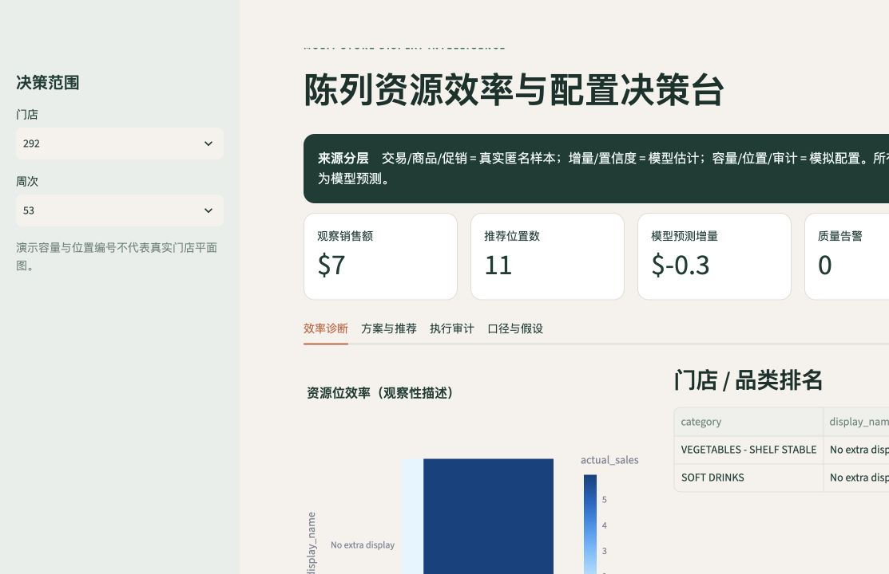

# 多门店陈列资源位效率评估与约束优化系统

> Multi-store Display Resource Efficiency & Allocation Optimization

这是一个可运行、可复现的零售空间运营作品集项目：从 84.51° Complete Journey 的真实匿名样本出发，经 DuckDB/SQL 数据建模、质量审计、描述性效率分析、可解释基线估计，再用 Google OR-Tools CP-SAT 生成下一周期资源位类型配置，最后通过模拟现场审计闭环复盘。

**一期边界：优化“资源位类型/槽位配置”，不生成、也不声称生成精确门店平面图。**

## 项目亮点

- SQL 是主干：多表 JOIN、CTE、窗口函数、8 周移动基线、店内排名、跨店同品类比较、促销前后、叠加效果、特征宽表和执行复盘均在 SQL 中实现。
- 来源不混淆：真实匿名数据、模型估计和模拟业务配置有明确 `data_source` 标签。
- 建模不越界：固定效应 Ridge 反事实结果是模型预测，不是因果提升；时间窗口排除当前周，验证按时间切分。
- 优化可解释：容量、品类上下限、唯一分配、适配、品类集中度、每周调整数、战略保留和低置信度约束均可审计。
- 方案可对比：当前配置、无约束贪心、CP-SAT 三方案共用指标体系。
- 执行可闭环：模拟审计覆盖匹配、时效、照片、未知品类、重复占用和推荐追溯。

## 数据真实性契约

| 类型 | 内容 | 标记 |
|---|---|---|
| 真实匿名数据 | Complete Journey 的交易、商品、促销与陈列位置 | `real_anonymized` |
| 模型估计数据 | 无特殊陈列基准、预测增量、支持度置信分 | `model_estimate` |
| 模拟业务配置 | 门店容量、位置编号、当前配置、调整成本、适配、政策和现场审计 | `simulated` 或 `model_estimate+simulated_configuration` |

陈列分配不是随机实验。库存、选品、客流、价格、门店执行等未观测变量可能同时影响陈列和销售。因此：

- 高销售不能直接解释为陈列带来的因果提升；
- 促销前后、跨店排名和叠加效果只作描述性分析；
- `predicted_incremental_sales` 与方案收益一律是**模型预测/情景模拟**，不是实际落地提升。

详细口径见 [数据来源与定义](docs/data_sources_and_definitions.md) 和 [方法与限制](docs/methodology.md)。

## 快速运行

推荐 macOS/Linux 与 Python 3.11+。本仓库已包含由官方包样本转换的小型 Parquet demo，因此首次体验无需处理 2,094 万条完整促销数据。

```bash
# 1) 建立隔离环境并安装依赖
make setup

# 2) 可选：从官方仓库重新下载并生成 demo
make demo

# 3) 一键构建 SQL、模型、优化与审计闭环
make build

# 4) 生成可独立打开的 HTML 报告并运行测试
make report
make test

# 5) 打开交互看板
make dashboard
```

如系统默认 `python3` 低于 3.11，可指定解释器，例如 `make setup BASE_PYTHON=/path/to/python3.12`。

离线报告：[outputs/portfolio_report.html](outputs/portfolio_report.html)  
推荐 CSV：[outputs/allocation_recommendations.csv](outputs/allocation_recommendations.csv)  
情景对比：[outputs/scenario_comparison.csv](outputs/scenario_comparison.csv)

若本机不是 `/opt/anaconda3/bin/python`，可直接执行：

```bash
python3 -m venv .venv
.venv/bin/pip install -e ".[dev]"
.venv/bin/python -m display_optimizer.cli run-all
```

## 已验证的 demo 结果

当前构建包含 3,007 条真实匿名交易样本、126,080 条真实匿名促销样本、14,916 个商品；生成 88 条模拟资源位推荐。

| 方案 | 模型预测增量销售合计 | 调整数 | 模拟调整成本 | 约束违反 |
|---|---:|---:|---:|---:|
| 当前配置 | -2.08 | 0 | 0.00 | 0 |
| 无约束贪心 | -1.95 | 81 | 1,794.55 | 29 |
| OR-Tools 约束优化 | -2.07 | 32 | 635.48 | 0 |

88 个槽位均取得 `OPTIMAL`。这里的负值不是实际亏损，也没有被包装成“提升”：官方 demo 的促销抽样与交易抽样极稀疏，模型总体估计特殊陈列情景低于无额外陈列情景。优化器在约束下选择的是模型预测损失更小、调整成本可控的方案。

时间后段测试集当前指标：MAE 约 0.052、R² 约 0.685；这是预测验证，不是因果识别指标。精确值见 [model_metrics.json](outputs/model_metrics.json)。

## 数据模型

```text
raw_transactions ─┐
raw_promotions ───┼─> dim_* / fact_* ─> descriptive marts / model features
raw_products ─────┘                              │
                                                ├─> Ridge baseline/effects
simulated capacity/current/policy/fit ──────────┴─> candidates
                                                     ├─> current
                                                     ├─> greedy
                                                     └─> CP-SAT recommendations
                                                               └─> simulated audit/review
```

要求的核心表全部落在 DuckDB：

- 原始层：`raw_transactions`、`raw_promotions`、`raw_products`
- 维度层：`dim_store`、`dim_product`、`dim_display_location`、`dim_week`
- 事实层：`fact_transactions`、`fact_product_display`、`fact_store_week_category`
- 分析层：`mart_display_performance`、`mart_display_baseline`、`mart_incremental_effect`、`mart_allocation_candidates`、`mart_allocation_recommendations`、`mart_space_audit`

完整字段、主键、粒度、来源与质量规则见 [数据字典](docs/data_dictionary.md)，整体图见 [项目架构](docs/architecture.md)。

## 目录结构

```text
.
├── config/                 # 项目/优化参数
├── dashboard/              # Streamlit 管理看板
├── data/
│   ├── demo/               # 官方真实匿名小样本（Parquet）
│   ├── simulated/          # 明确标记的模拟运营配置/审计
│   └── warehouse/          # DuckDB 成品库
├── docs/                   # 架构、字典、口径、方法、面试提纲
├── outputs/                # 推荐、指标、HTML 报告和截图
├── scripts/                # 下载、报告、数据字典脚本
├── sql/                    # 分层模型、DQ、分析、复盘 SQL
├── src/display_optimizer/  # 模型、优化器、流水线
└── tests/                  # 自动化验收
```

## 关键业务实现

### SQL 与数据质量

- `fact_product_display` 对上游可能重复的 `product_id × store_id × week` 明确保留 `raw_record_count` 并确定性解析；不静默删除。
- `mart_display_baseline` 使用不含当前周的移动窗口。
- `dq_results` 检查重复、关键字段空值、周次范围、展示/mailer 异常编码、产品关联缺失和负销售异常。
- `analysis_promotion_pre_post` 与 `analysis_promotion_stack` 明确标注 descriptive/not causal。

### 增量基线

控制商品固定效应、门店、周次/季节、品类、零售折扣、优惠券、mailer、历史商品-门店销售、历史门店-品类销售和商品先验畅销度。反事实将展示编码设为 0：

```text
predicted_incremental_sales =
  predicted_sales_with_display - expected_sales_without_special_display
```

### 约束优化与不可行兜底

CP-SAT 决策变量表示某门店某模拟槽位是否分配给某品类。硬约束覆盖容量/唯一分配、适配、品类上下限与集中度、最大调整数、总部战略保留和低置信度上限。

若严格模型不可行，程序会：记录初始状态与诊断 → 放宽调整/置信/战略下限 → 仍不可行则使用仅选适配候选的贪心兜底。`solver_status` 与 [infeasibility_diagnostics.csv](outputs/infeasibility_diagnostics.csv) 会暴露这一事实。当前 demo 无不可行门店，所以诊断文件只有表头。

## 看板内容

Streamlit 看板支持门店和周次筛选，展示资源位效率、门店/品类排名、当前与推荐配置、reason code、预测增量、置信度、调整成本、数据质量、审计异常以及模型边界。信息架构为本项目原创，不复刻其他零售产品界面。



## 与零售空间运营岗位的映射

| 岗位能力 | 项目证据 |
|---|---|
| 空间效率评估 | 资源位/品类/门店多层排名与低效识别 |
| 资源位数字化 | 资源类型、模拟槽位 ID、容量、适配和分配事实表 |
| 空间审计 | 计划/现场、时效、照片、异常、推荐追溯 |
| 数据口径建设 | 分层模型、数据字典、来源契约与 DQ 状态 |
| AI/模型落地 | 可解释反事实估计、模型版本、置信度和限制 |
| 运筹优化 | 多约束 CP-SAT、基线对比、不可行诊断与兜底 |
| 管理沟通 | Streamlit 决策台、离线 HTML、reason code |

## 文档导航

- [项目架构](docs/architecture.md)
- [数据字典](docs/data_dictionary.md)
- [数据来源、指标口径与使用边界](docs/data_sources_and_definitions.md)
- [模型与优化方法](docs/methodology.md)
- [实施计划与验收](docs/implementation_plan.md)
- [面试讲解提纲](docs/interview_guide.md)
- [English summary](README_EN.md)

## 数据来源与许可

数据来自 [bradleyboehmke/completejourney](https://github.com/bradleyboehmke/completejourney)，其 `DESCRIPTION` 声明 CC0；原始来源为 84.51° Complete Journey 2.0。项目代码采用 MIT License。
