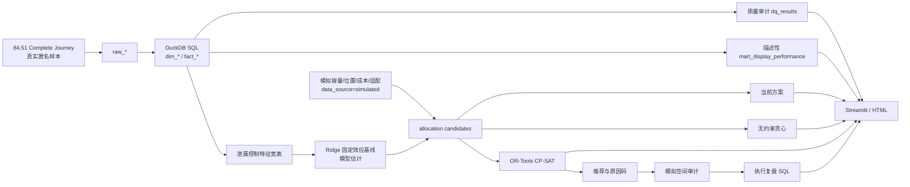

# 项目架构

一期的决策对象是“资源位类型/位置槽位配置”，不是几何坐标或精确门店平面图。`resource_position` 是模拟运营槽位 ID。

## 运行顺序

1. `scripts/download_data.py`：下载/转换官方包样本。
2. `sql/00_raw.sql` 至 `sql/50_analysis.sql`：原始层、维度层、事实层、分析层和质量检查。
3. `simulate.py`：生成带来源标签的运营配置。
4. `model.py`：时间切分验证、反事实预测和候选宽表。
5. `optimize.py`：三方案对比、CP-SAT、诊断与审计模拟。
6. `sql/60_review.sql`：推荐到执行的追溯复盘。
7. `dashboard/app.py` / `scripts/export_report.py`：交付展示。

